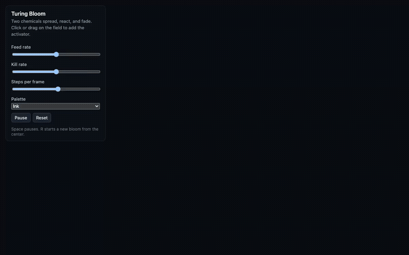

# Photon Ring

A browser ray tracer for a non-spinning black hole. Each pixel follows the path of light backward from the observer, around the hole, and into the sky or the accretion disk.

**Live page:** https://squoraishee.github.io/photon-ring/



[Full-quality video (MP4)](demo.mp4)

Press `C` or click **Controls** to open the panel. The page starts with the panel hidden.

## What it shows

Near a black hole, light paths bend. The bending is strong enough to show three things:

- **The shadow.** Light that passes closer than `b = 3√3 M`, about `5.2 M`, falls into the hole. The dark disk it leaves behind has that radius.
- **The photon ring.** Light that passes just outside the shadow circles the hole several times before it escapes. That light forms a thin, bright ring at the shadow edge.
- **The lensed disk.** Light from the back of the accretion disk bends up and over the shadow. In a tilted view, the far side of the disk appears as an arch above and below the dark region.

## The math

Light follows a null geodesic. For a ray that stays in one plane through the hole, with `u = 1/r` and `phi` the angle swept in that plane, the orbit equation for a Schwarzschild black hole is

```
d2u/dphi2 = -u + 3 M u^2
```

The first-order form is `(du/dphi)^2 = 1/b^2 - u^2 + 2 M u^3`. The function `u^2 - 2 M u^3` peaks at the photon sphere, `r = 3M` (`u = 1/3M`). Its peak value sets the critical impact parameter, `1/b_c^2 = 1/27M^2`, so `b_c = 3√3 M`.

The page solves this equation for every pixel, with a midpoint integrator in `phi`:

- If `u` reaches `1/(2M)`, the ray has crossed the horizon. The pixel is dark.
- If `u` drops toward zero, the ray has escaped. The pixel takes the sky color in the direction the ray left.
- Each time the ray crosses the plane of the disk inside the disk's radii, the disk's light adds to the pixel. A ray can cross the disk more than once, which produces the higher-order images.

The disk pattern rotates at the Keplerian angular speed `Omega = r^(-3/2)`, so inner features move faster than outer ones. The page runs simulated time 20 times faster than the clock, so the rotation is visible within a few seconds.

## What it does not do

- **No spin.** This is a Schwarzschild hole. A spinning (Kerr) hole shifts the shadow and makes it asymmetric. Real M87* and Sagittarius A* are thought to spin, so this view is a simplified case.
- **No Doppler beaming or redshift.** The disk glow is brightest at the inner edge, but the models for brightness and color are schematic. The brightness falls off as `r^-3`, and the color ramps from white to orange.
- **No polarization.** The Event Horizon Telescope results below are polarization images. This page shows total intensity only.

## Reported work

- Event Horizon Telescope collaboration (September 2025). New M87* images combine 2017 data with observations from 2018 and 2021 and show changing polarized structure near the event horizon. The results were published in *Astronomy & Astrophysics*. [Secondary coverage from PCUV](https://news.pcuv.es/en/home-pcuv-institutos-pcuv-oauv-event-horizon-telescope-eht-which-oauv-is-part-reveals-unexpected-changes-polarization-light-black-hole-m87)
- "Photon Ring Symmetries in Simulated Linear Polarization Images of Messier 87*," [arXiv:2203.00844](https://arxiv.org/pdf/2203.00844). Simulation work on the symmetry of the photon ring in polarized light.
- "Prospects for the Detection of the Sgr A* Photon Ring with next-generation Event Horizon Telescope Polarimetry," [arXiv:2407.09750](https://arxiv.org/html/2407.09750v1). Predicts a photon ring signal for Sagittarius A* at 345 GHz with simulated data. This is a prediction, not an observation.

## Controls

- **Presets** set the viewing angle and disk settings for face-on, edge-on, tilted, and no-disk views.
- **Viewing angle** rotates the observer from above the disk (0°) to edge-on (90°).
- **Observer distance** and **field of view** set the framing. The shadow's angular size shrinks with distance, and the readout shows the value.
- **Accretion disk** toggles the disk. The inner edge defaults to the innermost stable circular orbit, `6 M`. The outer edge defaults to `20 M`.
- **Disk rotation** sets the speed of the pattern. At 0, the page only redraws when a control changes.
- **Background grid** draws latitude and longitude lines on the sky. Lensing bends them, which makes the distortion easy to see.
- **Exposure**, **Palette**, and **Pause** change the look.
- `Space` pauses. `C` opens and closes the panel.

## Linking to a moment

Add `t` and `paused` to the URL to start at a fixed point in simulated time:

```
?t=4&paused
```

The page keeps the same time when it loads, so a frame can be shared or recorded exactly.

## Tech

- Plain WebGL2 with one fragment shader that traces every pixel
- Plain JavaScript modules, no build step, no dependencies
- Rendering runs at 80% of the window size and is upscaled by CSS, to keep frame cost manageable

## Running it

Serve the folder and open it in a browser. A local server avoids module loading problems in some browsers:

```
python3 -m http.server 8000
```

Then open http://localhost:8000.
