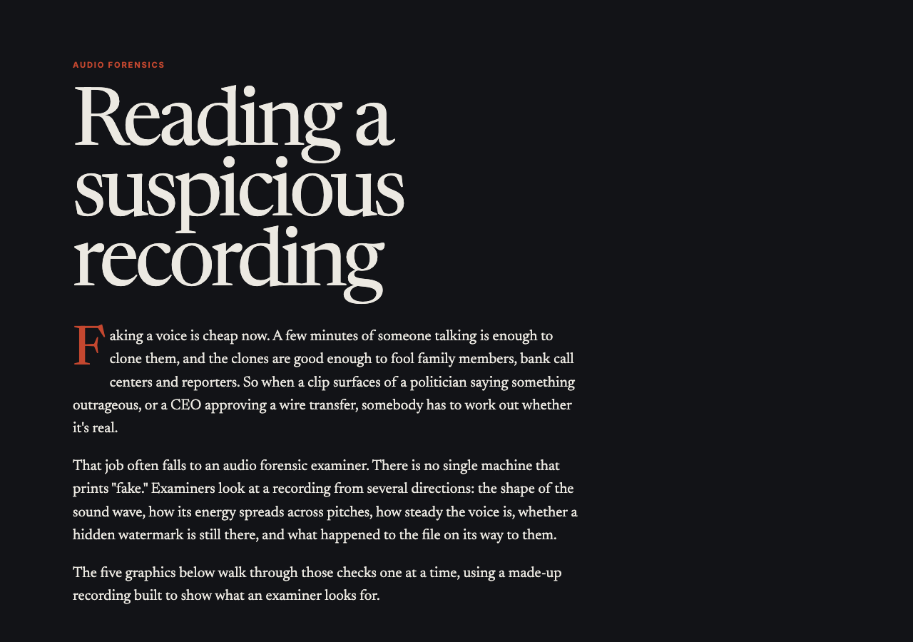

# Prototypes

A collection of small browser projects. Each one lives in its own folder with a README, a screenshot, and the source.

## Projects

### [The Luminous Basin](luminous-basin/)

A living Gaussian splat landscape. Trees, rivers, ruins, and a floating crystal are all built from splats in the browser, with time of day, fog, wind, and rain you can control.

**Live page:** https://squoraishee.github.io/the-luminous-basin/

### [Snakephoria](snakephoria/)

A party-snake campaign. Grow a cake chain, chase friends through a festival map, and beat the bosses on the way to the finale. It has 21 levels, 10 party friends to find, and auto-save.

**Live game:** https://squoraishee.github.io/snakephoria/

### [Reading a Suspicious Recording](audio-forensics/)

An illustrated guide to how an audio forensic examiner checks whether a recording is real. It covers the waveform, the spectrogram, pitch wobble, hidden watermarks, and file history, using a made-up recording.

**Live page:** https://squoraishee.github.io/audio-forensics/

## Running them

The Luminous Basin and Snakephoria are plain HTML, CSS, and JavaScript. Open the `index.html` file in a modern browser. The Luminous Basin loads Three.js from a CDN, so it needs an internet connection.

## How they were made

Most of this was written by hand. AI helped with the parts that were new to me, such as the rendering techniques and building the controls. Think of these as learning projects and working demos.
