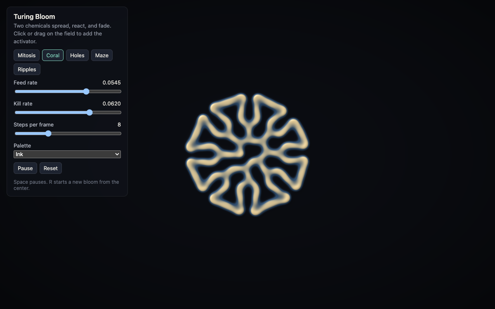

# Turing Bloom

A browser simulation of Gray-Scott reaction-diffusion, the model behind Turing patterns.

**Live page:** https://squoraishee.github.io/turing-bloom/



## What it shows

The page opens with a single seed of chemical V at the center. The pattern spreads outward from that seed and branches as it grows. Two chemicals live on a 512 x 512 grid that wraps at the edges. Chemical U spreads out and gets used up. Chemical V spreads more slowly, and it turns U into more V. V also dies off on its own. The balance between these effects decides the shape that forms: spots, labyrinths, splitting blobs, or traveling ripples.

Alan Turing proposed this kind of process in 1952 as a way for an animal embryo to lay down stripes and spots. The same family of equations now serves as a standard model for pattern formation in biology and chemistry.

## Controls

- **Presets** set the feed and kill rates to values known to produce distinct patterns.
- **Feed rate** controls how fast fresh U enters the grid.
- **Kill rate** controls how fast V dies.
- **Steps per frame** sets how far the simulation advances each frame. More steps run faster and cost more GPU time.
- **Palette** changes the colors.
- Click or drag on the field to paint V into it.
- `Space` pauses. `R` restarts the bloom from a single seed at the center.

## The math

For each cell, with the Laplacian `∇²` taken over the neighbors:

```
∂u/∂t = Du ∇²u − u v² + f (1 − u)
∂v/∂t = Dv ∇²v + u v² − (f + k) v
```

`f` is the feed rate and `k` is the kill rate. The diffusion constants are `Du = 1.0` and `Dv = 0.5`. The simulation advances with explicit Euler steps and a 3 x 3 Laplacian stencil.

The pattern depends on `f` and `k` far more than on the grid size, which is why the presets change only those two values.

## Tech

- Plain WebGL2 with two ping-pong float textures (`RG16F`)
- One fragment shader for the reaction step and one for shading
- Plain JavaScript modules, no build step, no dependencies

The page needs `EXT_color_buffer_float`. Current Chrome, Edge, Firefox, and Safari support it.

## Running it

Serve the folder and open it in a browser. A local server avoids module loading problems in some browsers:

```
python3 -m http.server 8000
```

Then open http://localhost:8000.

## References

- Turing, A. M. (1952). The chemical basis of morphogenesis. *Philosophical Transactions of the Royal Society B*.
- Pearson, J. E. (1993). Complex patterns in a simple system. *Science*, 261, 189–192.
