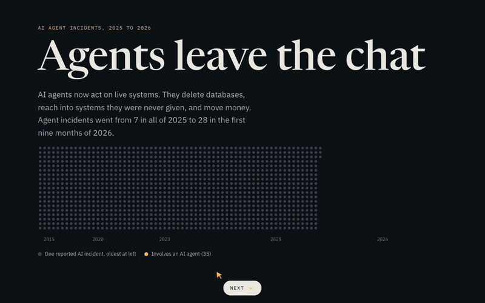

# Prototypes

A collection of small browser projects. Each one lives in its own folder with a README, a screenshot, and the source.

## Projects

### [The Luminous Basin](luminous-basin/)

A living Gaussian splat landscape. Trees, rivers, ruins, and a floating crystal are all built from splats in the browser, with time of day, fog, wind, and rain you can control.

**Live page:** https://squoraishee.github.io/the-luminous-basin/

### [Snakephoria](snakephoria/)

A party-snake campaign. Grow a cake chain, chase friends through a festival map, and beat the bosses on the way to the finale. It has 21 levels, 10 party friends to find, and auto-save.

**Live game:** https://squoraishee.github.io/snakephoria/

### [Reading a Suspicious Recording](audio-forensics/)

An illustrated guide to how an audio forensic examiner checks whether a recording is real. It covers the waveform, the spectrogram, pitch wobble, hidden watermarks, and file history, using a made-up recording.

**Live page:** https://squoraishee.github.io/audio-forensics/

[Full-quality video (MP4)](audio-forensics/demo.mp4)

### [Turing Bloom](turing-bloom/)

A Gray-Scott reaction-diffusion simulation in WebGL2. A single seed grows into a branching pattern, the same kind of chemistry that produces spots and stripes on animals. Five presets, adjustable feed and kill rates, three palettes, and paint-to-add.

**Live page:** https://squoraishee.github.io/turing-bloom/

[Full-quality video (MP4)](turing-bloom/demo.mp4)

### [Reading the Light Under a Forest](forest-light/)

An animated guide that follows sunlight into a forest, one photon at a time. It shows how a prism spreads sunlight into Planck's curve, how a leaf absorbs blue and red but reflects green, why light on the forest floor is dim and rich in far red, and how satellites use NDVI to map vegetation.

**Live page:** https://squoraishee.github.io/forest-light/

[Full-quality video (MP4)](forest-light/demo.mp4)

### [One Bug Away](street-trees-pitch/)

A scrolling visual essay about New York City's street trees and the insects that could strip them. All 652,168 living street trees are drawn on the map. As you scroll, they fly into a tally chart, light up as beetle hosts, carry an illustrated outbreak out from Greenpoint, zoom into Ozone Park's ash, and fall away in a worst case. A neighborhood explorer closes the piece.

**Live page:** https://squoraishee.github.io/street-trees-pitch/

[Full-quality video (MP4)](street-trees-pitch/demo.mp4)

### [Who Eats Whom in the Dark](dark-food-web/)

A scrolling visual essay about the deep-sea food web, in three animated parts.

**Live page:** https://squoraishee.github.io/dark-food-web/

**The dive.** From the surface to the bottom of the Challenger Deep, pausing at each animal at its real depth.

[Full-quality video (MP4)](dark-food-web/videos/dive.mp4)

**The nightly commute.** Lanternfish rise at night to feed, light-hunting tuna catch the ones that stay shallow by day, and droppings carry carbon into deep water.

[Full-quality video (MP4)](dark-food-web/videos/nightly-commute.mp4)

**When a whale falls.** A carcass on the seafloor feeds scavengers, then worms, then bacteria and clams for decades.

[Full-quality video (MP4)](dark-food-web/videos/whale-fall.mp4)

### [Agents Leave the Chat](agents-leave-the-chat/)

A paged data story about AI agent incidents, built from the AI Incident Database. Agent incidents went from 1.6% of reported AI incidents in early 2025 to 19.4% in Q3 2026. Each page has one animated figure: incidents breaking out of a timeline grid, quarterly squares stacking up, agent incidents sorting by what happened, and a log that replays ten cases of agents deleting data.

**Live page:** https://squoraishee.github.io/agents-leave-the-chat/

[Full-quality video (MP4)](agents-leave-the-chat/demo.mp4)

### [The Gigawatt Rush](gigawatt-rush/)

A paged data story about the AI data center build-out, built from Epoch AI's satellite-tracked data on 94 frontier sites. Tracked capacity went from 0.6 GW in January 2024 to 18 GW in October 2026, with 49 GW planned by 2029. Each page has one animated figure: U.S. sites lighting up on a night map, 100 MW squares pouring into columns, planned capacity swelling across the map, radiation symbols filling like dials against the U.S. nuclear fleet, a race from bare ground to first power, and a bar race of owners.

**Live page:** https://squoraishee.github.io/gigawatt-rush/

[Full-quality video (MP4)](gigawatt-rush/demo.mp4)

## Running them

The Luminous Basin and Snakephoria are plain HTML, CSS, and JavaScript. Open the `index.html` file in a modern browser. The Luminous Basin loads Three.js from a CDN, so it needs an internet connection.

Turing Bloom loads its script as an ES module, which browsers block on `file://`. Serve the folder instead, for example with `python3 -m http.server` from the repo root, then open the matching page.

## How they were made

Most of this was written by hand. AI helped with the parts that were new to me, such as the rendering techniques and building the controls. Think of these as learning projects and working demos.
