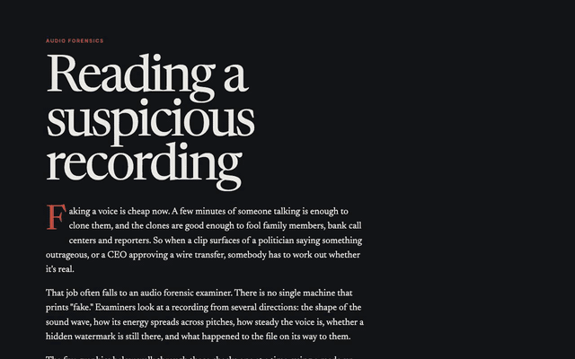

# Reading a Suspicious Recording

A short, illustrated guide to how an audio forensic examiner checks whether a recording is real. It walks through five checks on a made-up recording: the waveform, the spectrogram, the pitch wobble, a hidden watermark, and the file's history.

**Live page:** https://squoraishee.github.io/audio-forensics/

[Full-quality video (MP4)](demo.mp4)

## What it covers

1. **Zoom into the waveform.** Real voices never repeat each cycle exactly.
2. **Scan the spectrogram.** Copied and pasted audio repeats too precisely.
3. **Measure the wobble.** Real speakers drift a little in pitch, and synthetic voices often don't.
4. **Squeeze the watermark.** Some AI voice tools hide a signature, and compression can erase it.
5. **Follow the file's history.** Each export, upload, and re-recording leaves traces.

All of the figures are explanatory simulations, not measurements from a real recording or product.

## Source

The source is in a private repo. The live page is the public version.

Part of the [Prototypes](https://github.com/squoraishee/prototypes) collection.
