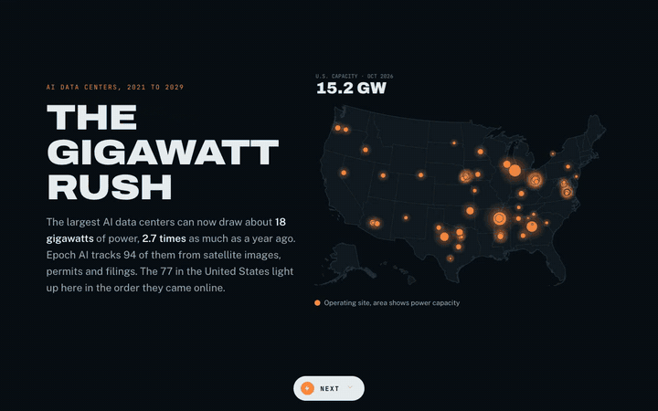

# The Gigawatt Rush

A paged data story about the build-out of AI data centers from 2021 to 2029, built from Epoch AI's satellite-tracked data on 94 frontier sites.

**Live page:** https://squoraishee.github.io/gigawatt-rush/

[Full-quality video (MP4)](demo.mp4)

## What the page shows

Each page has one animated figure that acts out its finding. A Next button moves you one page down, and the arrow keys and Page Up and Page Down work too.

1. **Cover.** A night map of the United States. The 77 U.S. sites light up in the order they first drew power, and a counter climbs to 15.2 GW.
2. **The growth.** Squares of 100 MW pour into one column per date: 0.6 GW in January 2024, 2.6 GW in January 2025, 8.6 GW in January 2026 and 18.1 GW in October 2026. The last column adds planned capacity, 49 GW by January 2029.
3. **The plans.** Blue rings swell around today's sites as the date runs to 2029. Two sites draw a gigawatt or more today. Fifteen U.S. sites pass that mark by January 2029.
4. **The scale.** 98 radiation symbols, one per gigawatt of U.S. nuclear capacity. AI capacity sweeps through them like dials: 15 GW today and 43 GW by 2029, or 44% of the nuclear fleet.
5. **The speed.** Seventy lines race from the first sign of construction to first power. Colossus 1 finishes in 109 days. The median site took 2.2 years.
6. **The builders.** A bar race of owners from today to 2029. Oracle, which owns most of the Stargate sites, rises from 0.7 GW to 8.4 GW and takes first place.
7. **Method and sources.**

## Data and method

The source is Epoch AI's Frontier Data Centers dataset, downloaded October 17, 2026 from https://epoch.ai/data/ai-data-centers. It is published under CC BY 4.0, and the two files the page uses are in `data/epoch/` with Epoch's own license note.

`data/build_sites.py` turns Epoch's timelines into `data/sites.json`, which is embedded in the page. Every total adds each site's latest value on that date. Values after October 17, 2026 are Epoch's projections from construction schedules, permits and company announcements.

`data/coords.py` holds town-level coordinates for each U.S. site, which I placed from the addresses in Epoch's data, or from the project's public location where Epoch gives no address.

The nuclear comparison uses the U.S. Energy Information Administration's figure of 98,441 MW net summer capacity from 96 reactors, as of March 2026.

## Limits

- Power is facility capacity, the most a site can draw at once, not the energy it uses.
- The nuclear comparison sets capacity against capacity. Data centers rarely run at full capacity, while nuclear plants run close to it all year.
- The dataset covers frontier-scale AI sites, not every data center.
- Most of the 2029 capacity has not been built yet. Plans can slip or be canceled.
- Owners are as Epoch tags them. Some sites have no disclosed owner.

## Running it

The page is a single `index.html` with no build step. Open it in a browser. It loads fonts from Google Fonts and the d3 and topojson libraries from cdnjs, so it needs an internet connection.

To rebuild the data, run `python data/build_sites.py` (needs pandas), then paste `data/sites.json` into the `sites-data` script tag in `index.html`.
