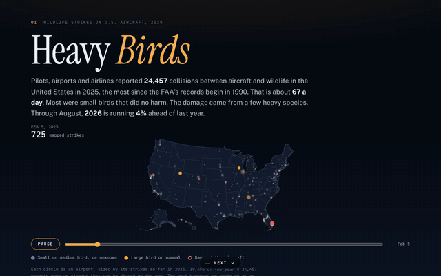

# Heavy Birds

A paged data story about wildlife strikes on U.S. aircraft, built from the FAA Wildlife Strike Database. Pilots, airports and airlines reported 24,457 strikes in 2025, the most since records begin in 1990, and 2026 is running 4% ahead through August. Most strikes are small birds that do no harm. The damage comes from a few heavy species, and some of them, like bald eagles, ospreys and black vultures, are being hit more often than the rise in reporting alone would explain.

[Full-quality video (MP4)](demo.mp4)

## What the page shows

Each page has one animated figure. A Next button moves you one page down, and the arrow keys and Page Up and Page Down work too.

1. **Cover.** Every 2025 strike at an airport that can be mapped, added day by day. Circles grow with each airport's strikes, amber for large animals and ringed in red where an aircraft was damaged. A slider picks a day.
2. **Eleven times as many reports as in 1990.** Strikes and damaging strikes each year, with 2026 through August.
3. **Small birds make up the count. Large ones do the damage.** 2025's strikes by size of the animal in squares of ten, for all strikes and for damaging ones.
4. **Which animals damage aircraft.** Every species or group with at least 60 strikes from 2015 to 2025, by strikes and share that caused damage, sized by repair costs.
5. **Eagles, ospreys and vultures are being hit more often.** Strikes in 2020 to 2024 against 1990 to 1994 for seven animals, against the growth of all strikes.
6. **Black vulture strikes have spread north.** Black vulture strikes by state in three periods.
7. **Most strikes happen near the ground. Higher ones do more harm.** Strikes and damage rate by height above ground, 2015 to 2025.
8. **Method and sources.**

## Data and method

The FAA publishes the database as an Access file, `database.zip`, at wildlife.faa.gov. The copy used here was downloaded November 8, 2026. It holds 359,793 reports, the latest dated October 28, 2026.

`data/build.py` downloads the database and the OurAirports airport list, exports the strike table to CSV with `data/Export.java`, and writes `data/strikes.json`. Python's Access readers drop the table's text columns, so the export uses Jackcess, which the script downloads from Maven Central. Downloads are cached in `data/raw/`, which isn't committed. `data/inline.py` embeds `strikes.json` and the state outlines (`states-albers.json`, from us-atlas) in `index.html`. The build needs Java, pandas and numpy.

- A damaging strike is one with `DAMAGE_LEVEL` M (minor), M? (uncertain), S (substantial) or D (destroyed).
- Size is the reporter's estimate (`SIZE`). Shares by size use the reports that give one.
- The 2026 comparison runs through August, the last month with most of its reports entered.
- Growth compares the five years 1990 to 1994 with 2020 to 2024. The "Gulls" label was split into individual species over the years, so gulls are left out of that comparison.
- Black vulture strikes are counted by the airport's state. Reports at foreign airports ("FN") are left out.
- Airports are placed by matching the FAA airport code to OurAirports' `ident`, `gps_code` or `icao_code`. 19,450 of 2025's 24,457 strikes can be placed. Most of the rest are en route or at an unnamed airport (`ZZZZ`).

## Limits

- Reporting is voluntary for most operators, and many strikes go unreported. Reporting has also grown much faster than strikes, so comparisons between species are fairer than raw counts over time.
- Many reports leave out the species, size, height, damage or cost. Each figure states how many reports it uses.
- Repair costs are given in a small share of reports, so the totals are a floor.
- Reports for the latest months are still coming in.

## Sources

- FAA Wildlife Strike Database: https://wildlife.faa.gov/
- U.S. Fish and Wildlife Service, Bald Eagle Population Size: 2020 Update: https://www.fws.gov/media/157107
- Cornell Lab of Ornithology, Black Vulture, citing the North American Breeding Bird Survey: https://www.allaboutbirds.org/guide/Black_Vulture/
- OurAirports: https://ourairports.com/data/
- us-atlas state outlines, from the U.S. Census Bureau: https://github.com/topojson/us-atlas

## Running it

The page is a single `index.html` that loads d3 and topojson from cdnjs. Serve the folder with any static server, such as `python3 -m http.server`, and open it. To rebuild the data, run `python3 data/build.py` and then `python3 data/inline.py`.

