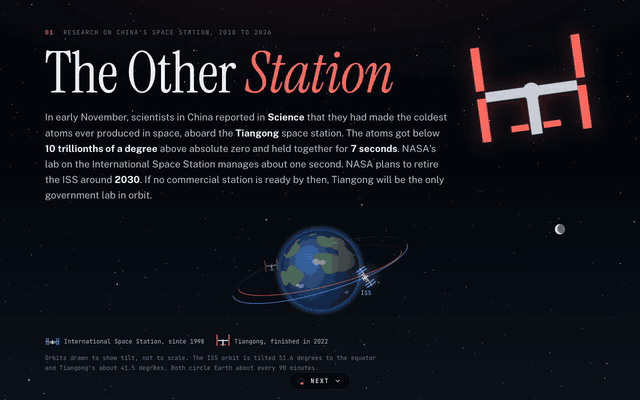

# The Other Station

A paged data story comparing research from China's Tiangong space station with research from the International Space Station. In early November 2026, a team in China reported in Science the coldest atoms yet made in space, aboard Tiangong. Across all fields, Tiangong produces about 15 research papers for every 100 from the ISS. In atomic and optical physics, materials, radiation and fluid physics, it produces 33 to 46. In human physiology and medicine, it produces 5.

**Live page:** https://squoraishee.github.io/prototypes/the-other-station/

## What the page shows

1. **Cover.** The two stations' orbits.
2. **About a sixth as many papers as the ISS.** Papers per year that name each station, 2010 to 2026.
3. **Strong in physics, nearly absent in biology.** Tiangong papers per 100 ISS papers in twelve fields, 2022 to 2026.
4. **Europe's next cosmic-ray detector is headed to Tiangong.** Co-author countries outside China.
5. **Where the coldest atoms in space are now made.** How long ultracold atom clouds held together on the ISS, in a German drop tower and on Tiangong.
6. **Method and sources.**

## Data

Counts come from OpenAlex, queried November 9, 2026, using title-and-abstract searches grouped by year, subfield and author country. `data/openalex_raw.json` holds the raw grouped counts and `data/station.json` the values the page uses. `data/inline.py` embeds `station.json` in `index.html`.

A paper counts for the ISS when its title or abstract contains "International Space Station." It counts for Tiangong when it names the China Space Station, Tiangong or its modules, or the Tiangong-1 and Tiangong-2 labs. Papers mentioning the CSST telescope, survey telescopes or the Tianhe supercomputer are left out. OpenAlex undercounts Chinese-language journals, so Tiangong's figures are likely low.
